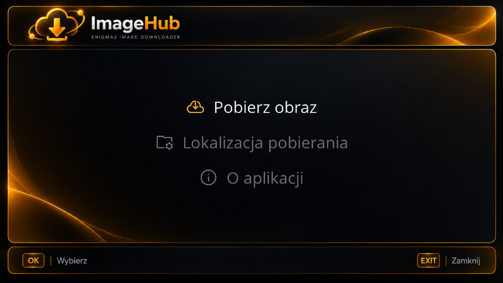
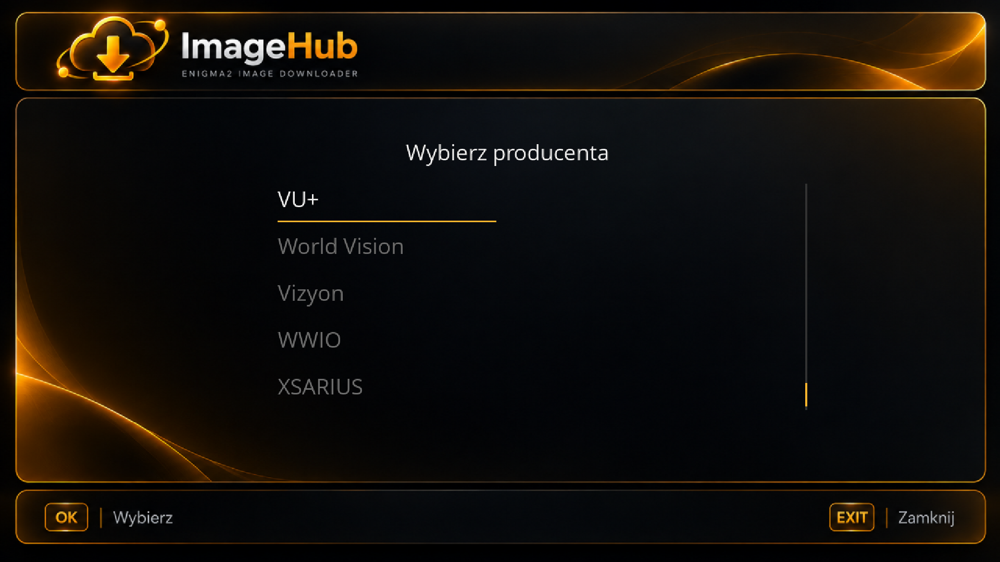
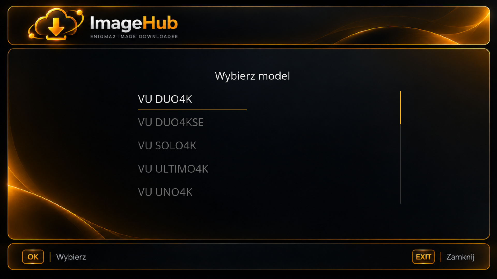
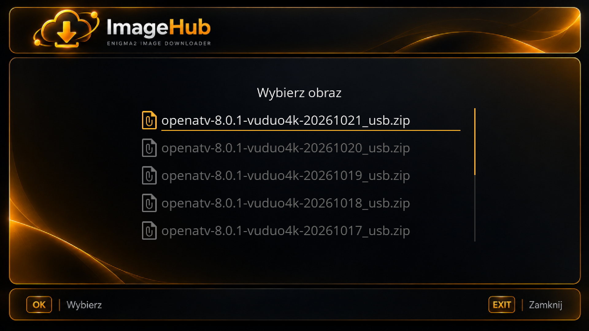
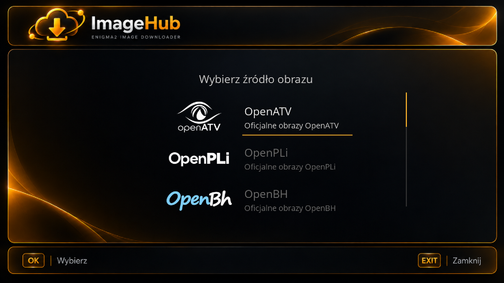
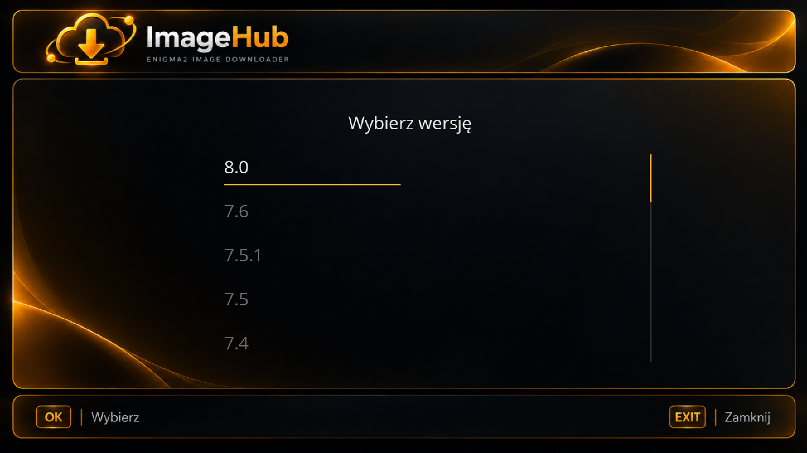
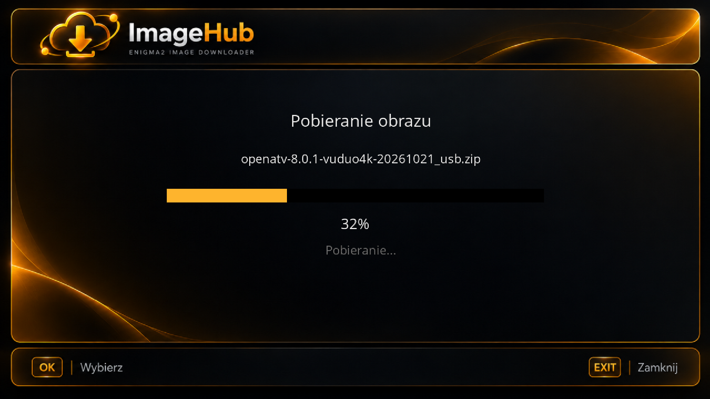

<p align="center">
  
</p>

<h1 align="center">ImageHub</h1>

<p align="center">
  Plugin Enigma2 do przeglądania i pobierania obrazów systemowych.
</p>
<p align="center">
  <a href="https://github.com/pardon14/ImageHub/releases">
    
  </a>
</p>

---

# 🇵🇱

**ImageHub** to plugin dla odbiorników Enigma2, który ułatwia przeglądanie i pobieranie obrazów systemowych dla różnych modeli tunerów.

Wybierz dystrybucję, znajdź swój model odbiornika i pobierz odpowiedni obraz — wszystko za pomocą jednego, przejrzystego interfejsu.

### Oficjalne źródła obrazów

ImageHub pobiera obrazy bezpośrednio z oficjalnych źródeł ich producentów i twórców. Pliki nie są przechowywane na własnych serwerach ImageHub — pobieranie odbywa się z serwerów udostępniających obrazy poszczególnych projektów.

## Funkcje

- Przeglądanie obrazów różnych dystrybucji Enigma2.
- Wybór wersji obrazu.
- Wybór producenta i modelu odbiornika.
- Pobieranie obrazów z oficjalnych źródeł.
- Monitorowanie postępu pobierania.
- Prosty i przejrzysty interfejs.

## Obsługiwane dystrybucje

OpenATV · OpenPLi · OpenBH · OpenDroid · OpenViX · OpenSPA · PurE2 · OpenVision · TeamBlue · SatDreamGr · VTi

Dostępność obrazów, wersji i modeli zależy od poszczególnych źródeł.

## Podziękowania i licencje

- **Ikony:** Google Fonts Icons, udostępniane na licencji Apache License 2.0.
  Źródło: https://fonts.google.com/icons
  Licencja: https://www.apache.org/licenses/LICENSE-2.0

- **Logotypy dystrybucji:** bazują na oryginalnych znakach graficznych, które zostały przetworzone przy użyciu AI. Ich wygląd może nieznacznie różnić się od oryginałów. Wszystkie prawa do znaków towarowych należą do ich właścicieli.

## Wymagania

- Python 2.7.x lub Python 3.x

## Instalacja

1. Połącz się z odbiornikiem Enigma2 przez SSH i wykonaj polecenie:
```bash
wget -qO- https://raw.githubusercontent.com/pardon14/ImageHub/master/install.sh | sh
```

Skrypt pobierze i uruchomi instalator ImageHub.

2. Pobierz pakiet `.ipk` z [Releases](https://github.com/pardon14/ImageHub/releases).

Zainstaluj go ręcznie na odbiorniku Enigma2.

## Zrzuty ekranu

<p align="center">
  <a href="assets/screenshots/main_menu.png">
    
  </a>
  <a href="assets/screenshots/manufacturer_selection.png">
    
  </a>
</p>

<p align="center">
  <a href="assets/screenshots/model_selection.png">
    
  </a>
  <a href="assets/screenshots/image_selection.png">
    
  </a>
</p>

<p align="center">
  <a href="assets/screenshots/source_selection.png">
    
  </a>
  <a href="assets/screenshots/version_selection.png">
    
  </a>
</p>

<p align="center">
  <a href="assets/screenshots/download_screen.png">
    
  </a>
</p>

---

# 🇬🇧

## About

**ImageHub** is an Enigma2 plugin that makes it easy to browse and download firmware images for different receiver models.

Choose a distribution, find your receiver model and download the appropriate image — all through one simple and intuitive interface.

### Official Image Sources

ImageHub downloads images directly from their official publishers and developers. Firmware images are not hosted on ImageHub's own servers; downloads come from the servers providing images for the respective projects.

## Features

- Browse images from multiple Enigma2 distributions.
- Select image versions.
- Choose your receiver manufacturer and model.
- Download images from official sources.
- Monitor download progress.
- Simple and intuitive interface.

## Supported Distributions

OpenATV · OpenPLi · OpenBH · OpenDroid · OpenViX · OpenSPA · PurE2 · OpenVision · TeamBlue · SatDreamGr · VTi

Image, release and receiver model availability depends on the respective sources.

## Credits and Licenses

- **Icons:** Google Fonts Icons, distributed under the Apache License 2.0.
  Source: https://fonts.google.com/icons
  License: https://www.apache.org/licenses/LICENSE-2.0

- **Distribution logos:** based on original logos processed using AI. Their appearance may differ slightly from the originals. All trademarks belong to their respective owners.

## Requirements

- Python 2.7.x or Python 3.x

## Installation

1. Connect to your Enigma2 receiver via SSH and run:
```bash
wget -qO- https://raw.githubusercontent.com/pardon14/ImageHub/master/install.sh | sh
```

The script will download and run the ImageHub installer.

2. Download the `.ipk` package from [Releases](https://github.com/pardon14/ImageHub/releases).

Install it manually on your Enigma2 receiver.

## Screenshots

<p align="center">
  <a href="assets/screenshots/main_menu.png">
    
  </a>
  <a href="assets/screenshots/manufacturer_selection.png">
    
  </a>
</p>

<p align="center">
  <a href="assets/screenshots/model_selection.png">
    
  </a>
  <a href="assets/screenshots/image_selection.png">
    
  </a>
</p>

<p align="center">
  <a href="assets/screenshots/source_selection.png">
    
  </a>
  <a href="assets/screenshots/version_selection.png">
    
  </a>
</p>

<p align="center">
  <a href="assets/screenshots/download_screen.png">
    
  </a>
</p>

---
